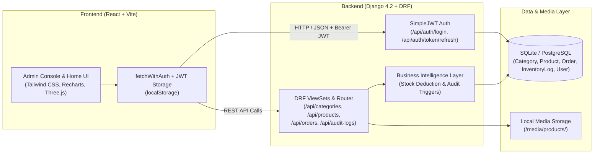
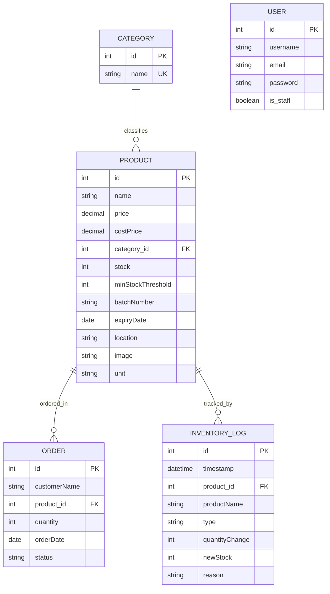
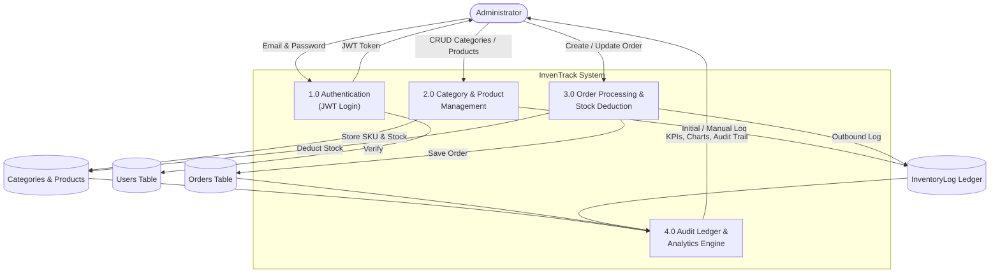
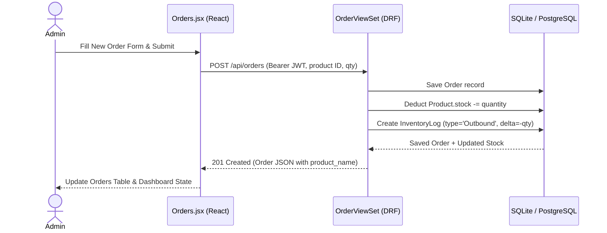
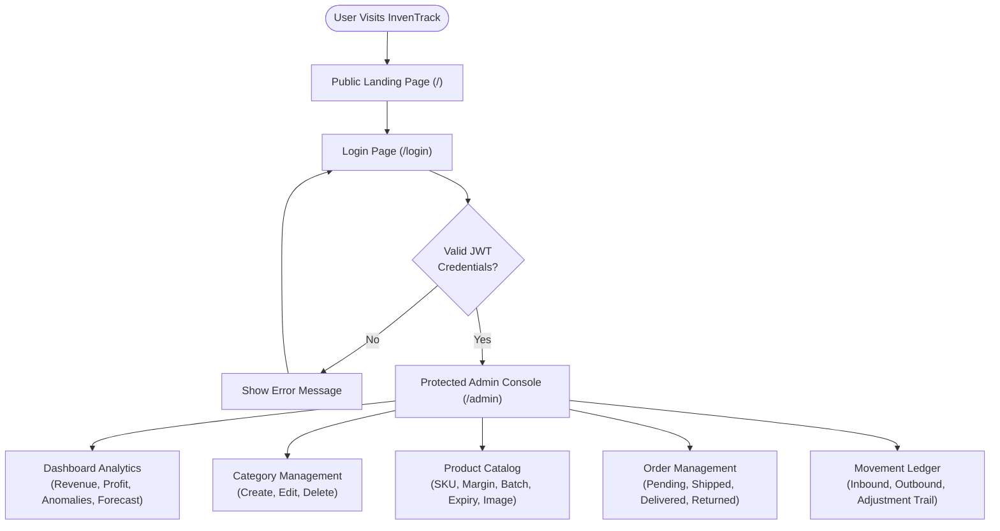

# InvenTrack: Project Architecture & Mermaid Diagrams

## 1. System Architecture

## 2. Entity-Relationship (ER) Diagram

## 3. Data Flow Diagram (DFD)

## 4. Order & Stock Synchronization Sequence Diagram

## 5. Application Navigation & Use Case Flow

